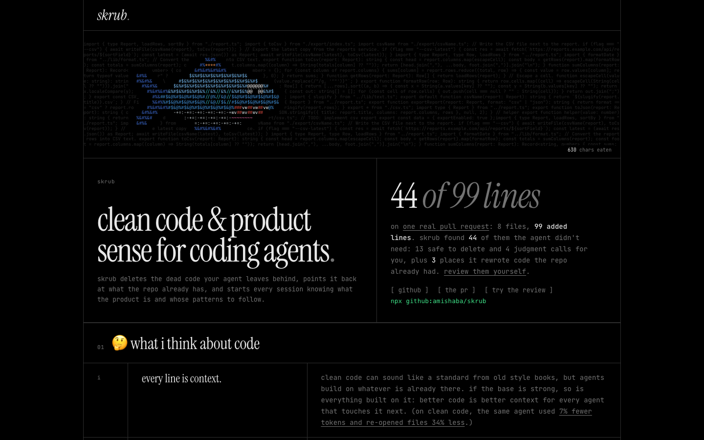

# skrub

clean code & product sense for coding agents.

[](https://github.com/amishaba/skrub/actions/workflows/ci.yml) · [live demo](https://unvibe-eight.vercel.app) · [sample pr](https://github.com/amishaba/skrub-sample/pull/1)

## why i built this

we live in an excess of typescript. producing code has become easier than ever.

in my experience, agents iterate per prompt rather than holistically, by which i mean taking in the whole repo: its conventions, shared api calls and components, tailwind classes, naming. ask a coding agent for a dropdown and there isn’t much stopping it from hand-writing a new one overfitted to your prompt, instead of reusing the dropdown component that already lives somewhere else in the codebase (the better pattern here).

none of this is a bug, per se. the code works, but a ton gets left behind: an export nobody imports, a wrapper that only calls the next function, a comment that repeats the line under it. nothing flags any of it, so it stays.

and all of it feeds back into the agent each time it indexes your codebase. that increases input token usage, yes, but it also throws off any convention, or dare i say tastefulness, in how the code is crafted. more functional garble feeds even more conventional garble, and it makes future rearchitectures and debugging insanely difficult.

clean code might be a standard from bygone days. but agents build on whatever is already there. the code is the base, and if the base is strong, so is everything built on it. every line you leave is context the next prompt reads. in [one controlled study](https://arxiv.org/html/2605.20049v1), the same agent passed just as often on clean code, but used 7% fewer tokens and re-opened files 34% less.

## what it does

skrub deletes the dead code your agent leaves behind, points it back at what the repo already has, and starts every session knowing what the product is and whose patterns to follow.

skrub finds what coding agents leave behind in typescript repos: an export nothing imports, a wrapper that only calls another function, a second copy of a helper the repo already had. it deletes what [knip](https://knip.dev) finds unused, typechecks the result, and flags the rest for you to decide.

inside claude code, it also works as a product engineer pair: before the agent builds, it's pointed at the problem behind the ask and at how the leading products in its space do the same thing.

the [sample pr](https://github.com/amishaba/skrub-sample/pull/1) is a coding agent's csv export. it changes 8 files and adds 99 lines. skrub's verdict:

> ## 16 deletions · 44 lines · ~358 tokens · 1 export to drop · 5 notes

<p align="center"><a href="https://unvibe-eight.vercel.app"></a></p>

## quick start

```bash
npx github:amishaba/skrub
```

run it in a typescript repo. it shows one finding at a time: `d` delete, `k` keep, `a` apply, `q` quit. nothing changes until you apply.

to set up claude code in the repo (conventions, what the product is, hooks and the skill), run this once:

```bash
npx github:amishaba/skrub init
```

needs node 20.19 or newer.

## what it finds

| finding | in the sample pr | |
| --- | --- | --- |
| unused imports, exports and files | `json.ts`, never imported | safe |
| exports only their own file uses | `formatRow` (skrub drops the `export`) | safe |
| comments that repeat the code | `// Escape a cell.` | safe |
| wrappers that only forward a call | `getRows`, which only calls `loadRows` | your call |
| a todo the code below may already do | `// TODO: implement csv export` | your call |
| copies of an existing helper | `sortRows`, the same as `sortBy` | your call |
| near-copies of existing code | `sumColumns`, 85% like `columnTotals` | note |
| a fetch another function already makes | the reports api, already wrapped by `fetchReport` | note |
| copied tailwind classes, tiny one-use files, `utils.ts` | `csvName.ts` | note |
| code that breaks the repo's conventions | `csvName.ts`: camelCase name, default export | note |

unused files and exports come from knip, which knows where vite, next.js, test runners and package.json start an app. unused imports come from the compiler. `skrub fix` deletes the safe findings, runs your `typecheck` script (or tsc), and puts back any file the deletions broke. skrub never deletes the rest for you. every finding is checked with `git apply --check` before you see it.

## in an agent's loop

`skrub init` sets up claude code in the repo:

- **what the product is**, at the top of `.claude/conventions.md`. skrub writes what the repo says it is, its surfaces (cli, web app, api, library, github action) and the ai it's built on. the agent fills in the rest on its first session: who uses it, the space and two or three products to model on, and what to copy from them. claude code asks you before it edits that file, so you approve or correct it.
- **conventions** in the same file, read from the code: file names, test placement, export style, naming habits. a rule is only written down when 80% of the code already follows it. the file also lists the components, hooks and helpers the most files import, so the agent uses those first.
- **a session start hook.** every session starts with the conventions and the product in context, and while the product isn't filled in, the agent fills it first.
- **a write hook.** before the agent creates a file that repeats something the repo has, skrub stops it once and says where the original is.
- **a stop hook.** when the agent says it's done, skrub checks the change. leftovers, broken conventions or rewrites block it once, with at most ten findings to fix. it also asks once if the product section is still empty.
- **a skill** that tells the agent when to read the conventions and to run `skrub fix` before finishing, plus [what a good product engineer does](skills/skrub/references/product.md) that no tool can check: the problem behind the ask, doing what's conventional in the space (for a devtool, how sentry, braintrust or posthog do it), the smallest change that works end to end, every state a user can hit, and using it like a user before saying it's done.

skrub only reports on what the agent's change wrote or left unused, never on old code it didn't touch.

## on pull requests

each finding becomes a comment on the pr, and the safe ones come with a one-click suggestion. judgment calls get none, since deleting a wrapper or a copy means updating its callers. needs `pull-requests: write`:

```yaml
- uses: actions/checkout@v4
  with: { fetch-depth: 0 }
- uses: amishaba/skrub@main
```

run your install step first, so knip can read configs like `vite.config.ts`. without it, skrub skips unused files and exports and says why.

## commands

install it in a project with `npm install --save-dev github:amishaba/skrub`, or use `npx github:amishaba/skrub` in place of `npx skrub`.

```bash
npx skrub                 # scan, then keep or delete in the terminal
npx skrub fix             # delete what's safe, typecheck, put back what broke (--dry-run to look first)
npx skrub check           # report; exit 1 if anything is safe to delete
npx skrub --against main  # only what this branch changed
npx skrub init            # product, conventions, hooks and skill for claude code
npx skrub conventions     # show where the code drifted from the conventions (--write to update)
```

skrub scans `src/` by default. set `include`, `exclude` and `entries` (files your framework loads by name, like `src/app/**/route.ts`) in `skrub.config.ts`, and `verify` for what `fix` runs after deleting (`false` skips it). knip also reads its own `knip.json` if the repo has one. with a `GEMINI_API_KEY` in your shell (or `SKRUB_GEMINI_API_KEY` in the repo's `.env`), an optional pass explains heuristic findings and can drop false positives. it never touches safe ones.

## develop

`npm ci && npm test`. ci also typechecks and fails if the demo in `web/` drifts from what the fixture produces.

one folder per step of a scan. each folder's entry point is the file named after it, and `commands/` only parses flags and prints.

```
config.ts      skrub.config.ts + package.json entries
knip/          run knip for unused files, exports and types
git/           git runner, diff → line ranges
program/       the ts-morph project, entries, who imports what
detect/        one file per finding kind
conventions/   mine the repo's rules, check new code against them
product/       what the repo is: its surfaces, the ai it's built on
llm/           optional gemini pass: review, explain
scan/          analyze → scope to the diff → dedupe → rank
store/         .skrub/ scans and decisions
patch/         build the patch, apply it, fix, typecheck and put back
report/        every number and sentence a reader sees
github/        pr context, inline notes, the summary comment
agent/         claude code hooks (session start, write, stop) and init
tui/ view/     the two review surfaces
```

mit
